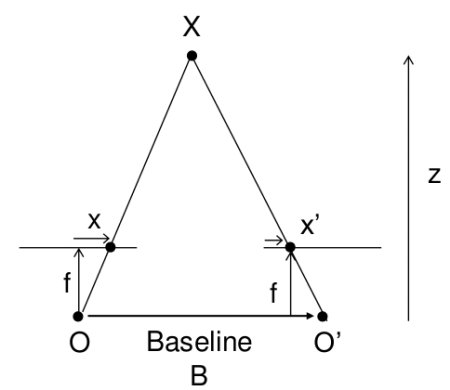
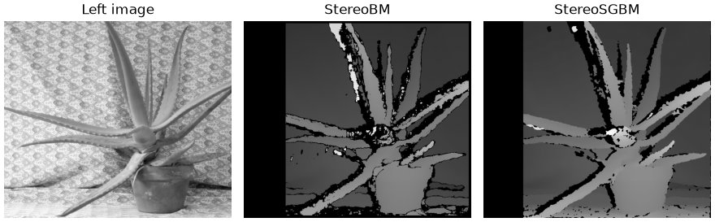
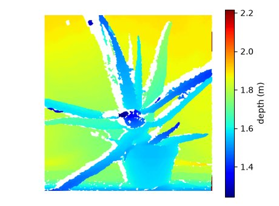

Depth Map from Stereo Images {#tutorial_py_depthmap}
============================

Goal
----

In this session,
    -   We will learn to compute a disparity map from a rectified stereo pair with StereoBM and StereoSGBM.
    -   We will learn to convert the disparity map into a depth map.

Basics
------

In the last session, we saw basic concepts like epipolar constraints and other related terms. We also
saw that if we have two images of same scene, we can get depth information from that in an intuitive
way. Below is an image and some simple mathematical formulas which prove that intuition.

The above diagram contains equivalent triangles. Writing their equivalent equations will yield us
following result:

\f[disparity = x - x' = \frac{Bf}{Z}\f]

\f$x\f$ and \f$x'\f$ are the distance between points in image plane corresponding to the scene point 3D and
their camera center. \f$B\f$ is the distance between two cameras (which we know) and \f$f\f$ is the focal
length of camera in pixels (already known). So in short, the above equation says that the depth of a point in a
scene is inversely proportional to the difference in distance of corresponding image points and
their camera centers. So with this information, we can derive the depth of all pixels in an image.

So it finds corresponding matches between two images. We have already seen how epiline constraint
make this operation faster and accurate. Once it finds matches, it finds the disparity. Below we
compute the disparity with two OpenCV matchers, StereoBM and StereoSGBM, on the same image pair, and
then convert it to depth.

The input is the *Aloe* pair from the [Middlebury 2006 stereo
datasets](https://vision.middlebury.edu/stereo/data/scenes2006/), shipped with OpenCV as
`samples/data/aloeL.jpg` and `samples/data/aloeR.jpg`. The images are already rectified, which both
matchers require: corresponding points must lie on the same image row. For your own cameras, calibrate
and rectify them first with cv.stereoCalibrate, cv.stereoRectify and cv.initUndistortRectifyMap. The
images are halved with cv.pyrDown to keep the examples fast.

Disparity with StereoBM
-----------------------

cv.StereoBM is a local block matcher. For every pixel of the left image it compares a
`blockSize` x `blockSize` window with windows on the same row of the right image, shifted by
`minDisparity` to `minDisparity + numDisparities - 1` pixels, and keeps the shift with the smallest
sum of absolute differences. It accepts only 8-bit single-channel images.
@code{.py}
import numpy as np
import cv2 as cv
from matplotlib import pyplot as plt

imgL = cv.pyrDown(cv.imread(cv.samples.findFile('aloeL.jpg'), cv.IMREAD_GRAYSCALE))
imgR = cv.pyrDown(cv.imread(cv.samples.findFile('aloeR.jpg'), cv.IMREAD_GRAYSCALE))

stereo = cv.StereoBM.create(numDisparities=112, blockSize=15)
disparity_bm = stereo.compute(imgL, imgR)

plt.imshow(disparity_bm, 'gray')
plt.show()
@endcode
The main parameters are:
- numDisparities: the search range in pixels, a multiple of 16. It must cover the largest disparity in
  the scene (about 106 for this pair), and a larger range costs more computation.
- blockSize: the odd window size, from 5 to 255. Small windows keep detail but are noisy, large windows
  are smooth but blur depth edges and thin structures.

The remaining parameters are set with setters after creation, see cv::StereoBM for details:
- setMinDisparity: the smallest disparity searched, 0 by default.
- setTextureThreshold: rejects windows with too little texture to match reliably.
- setUniquenessRatio: rejects a pixel if the best match is not better than the second best by this
  margin, in percent.
- setSpeckleWindowSize and setSpeckleRange: remove small blobs ("speckles") of disparity that differ
  from their surroundings, typical near object borders. Speckle filtering is off by default.
- setPreFilterType, setPreFilterSize and setPreFilterCap: normalize image brightness before matching.
  Normally you should not need to adjust these.

Disparity with StereoSGBM
-------------------------

cv.StereoSGBM implements the semi-global matching of H. Hirschmuller. It also matches small blocks,
but adds a penalty when the disparity changes between neighbouring pixels and minimizes the total cost
along several 1D paths through the image, which approximates a global smoothness constraint. On the
same pair:
@code{.py}
block = 5
stereo = cv.StereoSGBM.create(minDisparity=0, numDisparities=112, blockSize=block,
                              P1=8 * block**2, P2=32 * block**2,
                              disp12MaxDiff=1, uniquenessRatio=10,
                              speckleWindowSize=100, speckleRange=2)
disparity_sgbm = stereo.compute(imgL, imgR)

plt.imshow(disparity_sgbm, 'gray')
plt.show()
@endcode
minDisparity, numDisparities and uniquenessRatio mean the same as for StereoBM. The parameters that
differ are:
- P1 and P2: the penalties for a disparity change of 1 and of more than 1 between neighbouring
  pixels. Larger values give smoother disparity. P2 must be larger than P1; `8 * cn * blockSize**2`
  and `32 * cn * blockSize**2` are reasonable values, where `cn` is the number of image channels.
- blockSize: odd, and smaller than for StereoBM, typically 3 to 11, because the smoothness term already
  regularizes the result. `blockSize=1` matches single pixels.
- disp12MaxDiff: maximum difference, in pixels, between the left-to-right and right-to-left
  disparities. Pixels failing this check, mostly occlusions, are rejected. A non-positive value
  disables the check.
- speckleWindowSize and speckleRange: the same speckle filter as in StereoBM, here passed to the
  constructor. speckleRange is multiplied by 16 internally, so 1 or 2 is usually enough.
- mode: cv.STEREO_SGBM_MODE_SGBM (5 paths, the default), cv.STEREO_SGBM_MODE_HH (8 paths, the full
  Hirschmuller algorithm, more memory) or the faster cv.STEREO_SGBM_MODE_SGBM_3WAY.

StereoSGBM also accepts color images. It has no texture threshold; the smoothness term fills weakly
textured areas instead.

In short, StereoBM is fast and simple but leaves holes in weakly textured areas and is noisy at depth
edges. StereoSGBM gives a denser and smoother disparity map at a higher cost in time and memory: on
this pair it finds a disparity for more pixels and runs roughly ten times slower. Start with StereoBM
when speed matters, and use StereoSGBM when the quality of the map matters more. Both leave a band on
the left without disparity: those pixels cannot be searched over the full range, because their matches
would fall outside the right image.

From disparity to depth
-----------------------

Both matchers return disparity as 16-bit fixed-point numbers with 4 fractional bits, so divide by 16 to
get disparity in pixels. Pixels without a valid match get `(minDisparity - 1) * 16`, which is -1 after
the division here, so keep only `disparity > minDisparity - 1`. Zero disparity is not a point at infinity
for this pair: with the offset \f$d_{offs}\f$ below it still has a finite depth. The singularity is at
\f$d + d_{offs} = 0\f$, which is guarded separately.

Depth then follows from the equation above, \f$Z = \frac{fB}{d + d_{offs}}\f$. \f$f\f$ is the focal
length in pixels, \f$B\f$ the baseline, and \f$d_{offs}\f$ the difference between the principal points of
the two rectified images, zero for most rigs. \f$Z\f$ has the units of \f$B\f$. For the full-size Aloe
pair the dataset gives \f$f = 3740\f$ pixels, \f$B = 160\f$ mm and \f$d_{offs} = 270\f$ pixels, the last
one because the images were cropped. Halving the images halves \f$f\f$ and \f$d_{offs}\f$:
@code{.py}
f = 3740 / 2     # focal length in pixels, halved with the image
B = 0.160        # baseline in metres, so depth is in metres
doffs = 270 / 2  # principal point offset in pixels, halved with the image

min_disparity = 0  # the minDisparity the matcher was created with
disparity = disparity_sgbm.astype(np.float32) / 16.0
valid = (disparity > min_disparity - 1) & (disparity + doffs > 0)
depth = np.zeros_like(disparity)
depth[valid] = f * B / (disparity[valid] + doffs)

plt.imshow(np.where(valid, depth, np.nan), 'jet')
plt.colorbar(label='depth (m)')
plt.show()
@endcode

For a calibrated rig, cv.stereoRectify returns the 4x4 disparity-to-depth matrix `Q`, and
cv.reprojectImageTo3D uses it to compute the 3D point \f$(X, Y, Z)\f$ of every pixel, in the units of
the translation between the cameras found by cv.stereoCalibrate. Below `Q` is written out for the Aloe
pair in the form cv.stereoRectify returns it. The dataset does not give the principal point, so the
image centre is used; it affects only \f$X\f$ and \f$Y\f$:
@code{.py}
h, w = imgL.shape
Q = np.float32([[1, 0, 0, -w / 2],
                [0, 1, 0, -h / 2],
                [0, 0, 0, f],
                [0, 0, 1 / B, doffs / B]])
points = cv.reprojectImageTo3D(disparity, Q)
print(np.allclose(points[valid][:, 2], depth[valid]))  # True: Z equals the depth computed above
@endcode
As with the depth map, use only the points where `valid` is true.

Additional Resources
--------------------
- [Ros stereo img processing wiki page](http://wiki.ros.org/stereo_image_proc/Tutorials/ChoosingGoodStereoParameters)
- H. Hirschmuller, "Stereo Processing by Semiglobal Matching and Mutual Information", IEEE TPAMI, 2008.

Exercises
---------

-#  OpenCV samples contain an example of generating disparity map and its 3D reconstruction. Check
    stereo_match.py in OpenCV-Python samples.
