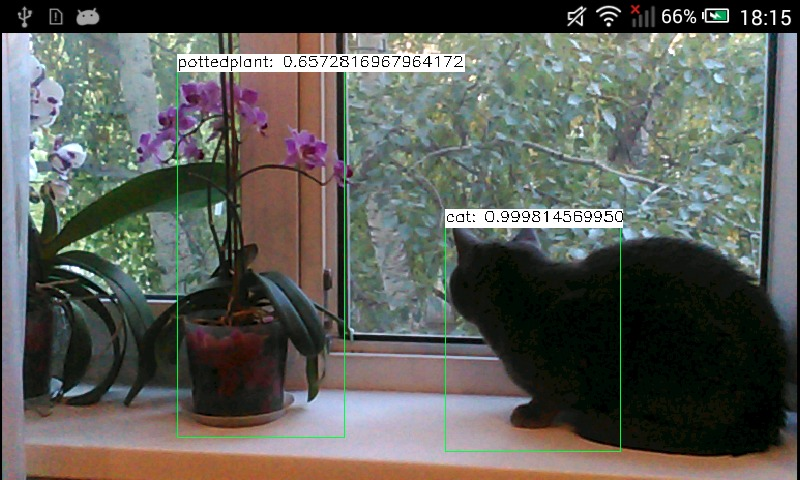

# How to run deep networks on Android device {#tutorial_android_dnn_intro}

@tableofcontents

@prev_tutorial{tutorial_dev_with_OCV_on_Android}
@next_tutorial{tutorial_android_ocl_intro}

@see @ref tutorial_table_of_content_dnn

|    |    |
| -: | :- |
| Original author | Dmitry Kurtaev |
| Compatibility | OpenCV >= 4.9 |

@tableofcontents

## Introduction
In this tutorial you'll know how to run deep learning networks on Android device
using OpenCV deep learning module.
Tutorial was written for Android Studio 2022.2.1.

## Requirements

- Download and install Android Studio from https://developer.android.com/studio.

- Get the latest pre-built OpenCV for Android release from https://github.com/opencv/opencv/releases
and unpack it (for example, `opencv-4.X.Y-android-sdk.zip`, minimum version 4.9 is required).

- Download the [SSD-MobileNetV1-12 ONNX model](https://huggingface.co/onnxmodelzoo/ssd_mobilenet_v1_12/resolve/main/ssd_mobilenet_v1_12.onnx) from the ONNX Model Zoo and save it as `mobilenet.onnx` in `app/src/main/res/raw`. Create the `raw` directory if it does not exist.

**Model compatibility:** The sample expects the SSD-MobileNetV1-12 ONNX model with the following interface:

- Input: UINT8 RGB tensor in NHWC layout, with shape `[1, height, width, 3]`. The model supports variable image dimensions.
- Input preprocessing: Raw RGB pixel values without normalization or mean subtraction.
- Outputs: Four tensors: `num_detections`, `detection_boxes`, `detection_scores`, and `detection_classes`.
- Dataset: COCO.

Other MobileNet-SSD models may have different input types, layouts, preprocessing requirements or output formats and may require corresponding changes to the sample.

## Create an empty Android Studio project and add OpenCV dependency

Use @ref tutorial_dev_with_OCV_on_Android tutorial to initialize your project and add OpenCV.

## Make an app

Our sample will takes pictures from a camera, forwards it into a deep network and
receives a set of rectangles, class identifiers and confidence values in range [0, 1].

- First of all, we need to add a necessary widget which displays processed
frames. Modify `app/src/main/res/layout/activity_main.xml`:
@include android/mobilenet-objdetect/res/layout/activity_main.xml

- Modify `/app/src/main/AndroidManifest.xml` to enable full-screen mode, set up
a correct screen orientation and allow to use a camera.
@code{.xml}
<?xml version="1.0" encoding="utf-8"?>
<manifest xmlns:android="http://schemas.android.com/apk/res/android">

    <application
        android:label="@string/app_name">
@endcode
@snippet android/mobilenet-objdetect/gradle/AndroidManifest.xml mobilenet_tutorial

- Replace content of `app/src/main/java/com/example/myapplication/MainActivity.java` and set a custom package name if necessary:

@snippet android/mobilenet-objdetect/src/org/opencv/samples/opencv_mobilenet/MainActivity.java mobilenet_tutorial_package
@snippet android/mobilenet-objdetect/src/org/opencv/samples/opencv_mobilenet/MainActivity.java mobilenet_tutorial

- Put the downloaded `mobilenet.onnx`
into `app/src/main/res/raw` folder. OpenCV DNN model is mainly designed to load ML and DNN models
from file. Modern Android does not allow it without extra permissions, but provides Java API to load
bytes from resources. The sample uses alternative DNN API that initializes a model from in-memory
buffer rather than a file. The following function reads model file from resources and converts it to
`MatOfBytes` (analog of `std::vector<char>` in C++ world) object suitable for OpenCV Java API:

@snippet android/mobilenet-objdetect/src/org/opencv/samples/opencv_mobilenet/MainActivity.java mobilenet_tutorial_resource

And then the network initialization is done with the following lines:

@snippet android/mobilenet-objdetect/src/org/opencv/samples/opencv_mobilenet/MainActivity.java init_model_from_memory

See also [Android documentation on resources](https://developer.android.com/guide/topics/resources/providing-resources.html)

- Take a look how DNN model input is prepared and inference result is interpreted:

@snippet android/mobilenet-objdetect/src/org/opencv/samples/opencv_mobilenet/MainActivity.java mobilenet_handle_frame

The camera frame is converted from RGBA to RGB and passed to the network as a UINT8 tensor in NHWC layout. No normalization or mean subtraction is applied.

The network returns four output tensors:

- `num_detections`: Number of detected objects.
- `detection_boxes`: Normalized bounding box coordinates in the order top, left, bottom, right.
- `detection_scores`: Confidence scores for each detection, ranging from 0 to 1.
- `detection_classes`: COCO class identifiers.

The sample filters detections using a confidence threshold and scales the normalized bounding box coordinates to the camera frame dimensions before drawing the detected objects.
 All coordinates are in range [0, 1] and should be scaled to image size before rendering.

- Launch an application and make a fun!

